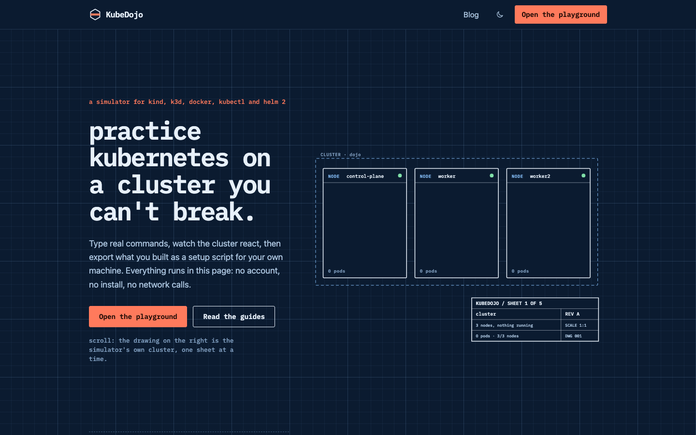
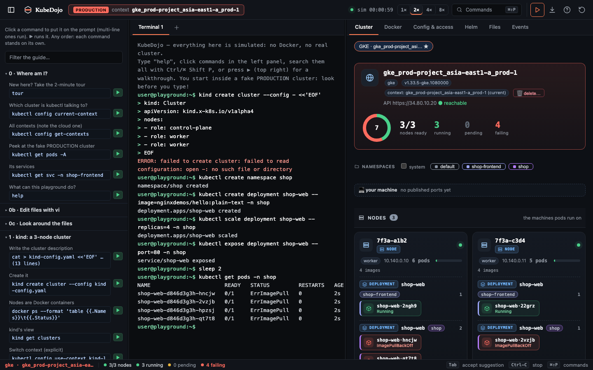
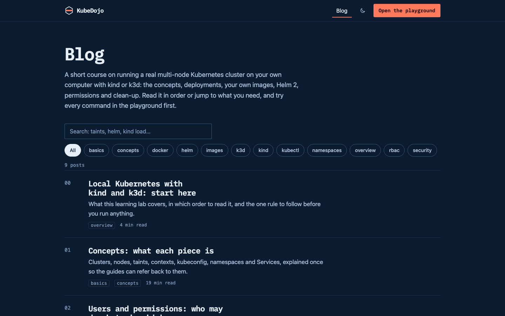
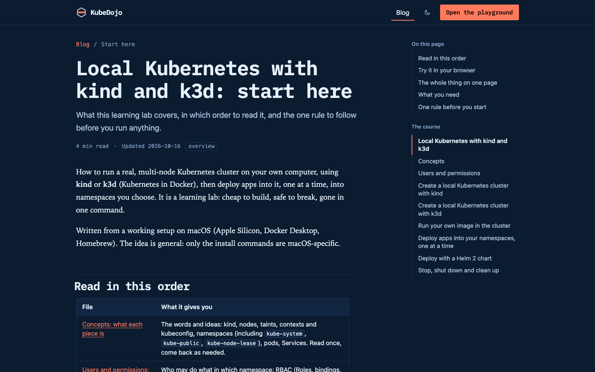
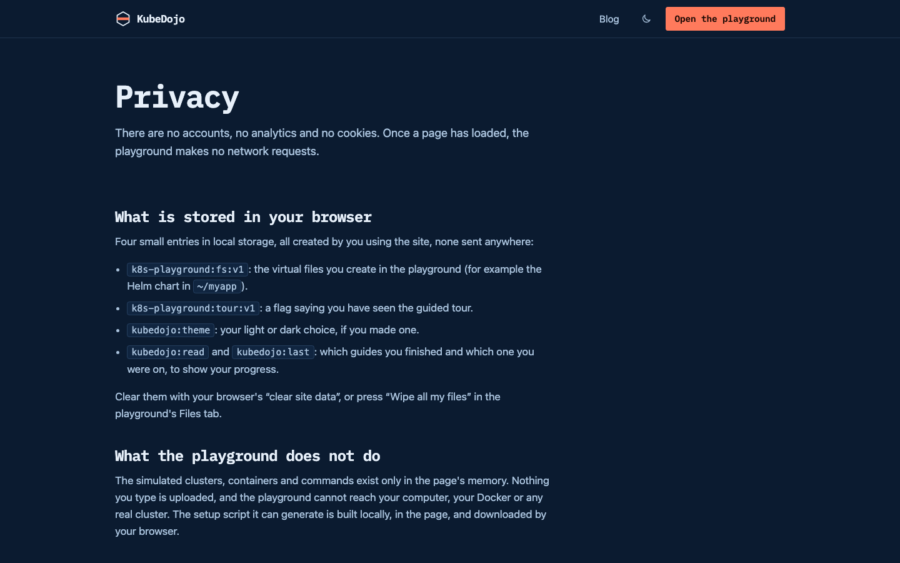

<div align="center">

# KubeDojo

**Practice Kubernetes on a cluster you can't break.**

A browser-only simulator for `kind`, `k3d`, `docker`, `kubectl` and Helm 2, paired with a short course that teaches the real thing, step by step. When you are happy with what you built, export it as a real `setup.sh` for your own machine.

[**Live demo**](#screenshots) · [**Quick start**](#quick-start) · [**Documentation**](#how-it-works) · [**Contributing**](#contributing) · [**License**](#license)

</div>

---

## ✨ Features

- 🧪 **Real commands, real outputs** — type the same `kubectl`, `kind`, `k3d`, `docker` and Helm 2 commands you would on a real cluster, and the simulator responds the way the real tool does.
- 🔒 **Fully sandboxed** — nothing leaves your browser. No network calls after load (the shipped CSP forbids them), no Docker, no real cluster, no account.
- 🗺️ **Live cluster view** — Nodes, Deployments, Pods, Services, ConfigMaps and Helm releases are visualised and animated, with health rings, live counters and `prefers-reduced-motion` support.
- 📦 **Export to a real setup script** — one click turns the cluster you built in the browser into a `setup.sh` you can run on your own machine.
- 📚 **Short, honest course** — 9 posts cover concepts, kind, k3d, deployments, images, Helm 2, RBAC and clean-up. A `bash` block that the simulator recognises automatically gets a **Try in playground** button.
- ⌨️ **Power-user friendly** — command palette (`Ctrl/⌘ Shift P`), resizable panes, tabs, history, fish-style suggestions, `vi`, keyboard tour, dark/light theme.
- 📱 **Mobile and phones** — one pane at a time on narrow viewports, with a bottom bar to switch between Guide, Terminal and Cluster.
- 🎓 **The Academy** (`/academy`) — six step-by-step courses (Kubernetes, Docker & Compose, Helm 3, Helm 2, Terraform, CI/CD & GitOps) with quizzes, inline practice simulators, **Simulate** (one-window experiments with guided steps, a practice terminal and challenges), and **Set up and try** on runnable Kubernetes commands. It has its own simulators and saved state, separate from the playground.
- 💾 **Sessions survive a reload** — the playground saves its simulated world and each terminal's history in the browser (Reset deletes them, `clear` deletes a terminal's); the Academy saves progress and every simulator session.
- 🧰 **Five build modes** — `dev` (HMR), `build` (prerendered static site), `build:single` (one offline HTML file with hash routing), `preview` (production-like server with CSP), and a Docker image.

---

## 📸 Screenshots

### Home — a live demo that becomes the playground



The home page is the marketing surface, but the SVG cluster on the right is the actual simulator's state, drawn one sheet at a time as you scroll.

### Playground — the simulator



Up to 4 terminals, ~240 guide commands, 6 live views (Cluster, Docker, Config & access, Helm, Files, Events), a modal `vi`, and an export button. Everything you build here can be downloaded as a real `setup.sh`.

### Course — a short, opinionated curriculum



9 posts, search, tag filters, table of contents, copy code, **Try in playground**, and reading progress — all rendered from the markdown in `content/blog/`. The build fails on broken links or anchors.

### One of the posts



### Privacy — short, transparent



---

## 🚀 Quick start

You need **Node 22+** and (only for the browser tests) Chrome.

```bash
git clone https://github.com/your-org/kubedojo.git
cd kubedojo
npm install
npm run dev          # http://localhost:5173
```

That's it — no Docker, no Kubernetes, no cloud account. The simulator runs entirely in your browser.

### Other build modes

```bash
npm run build          # prerendered static site in dist/   (Netlify/Cloudflare/Vercal/nginx ready)
npm run preview        # serve dist/ the way production should (routes, 404, CSP) on :4173
npm run build:single   # dist-single/index.html: the whole app in ONE offline file (hash routing)
npm run check          # lint + tests + build
```

---

## 🧰 Available scripts

| Command | What it does |
| --- | --- |
| `npm run lint` | ESLint on the app and the scripts |
| `npm test` | Engine scenarios (30 Node suites for the simulator) and unit tests for the blog and demo pipeline |
| `node scripts/e2e.mjs` | ~140 checks in headless Chrome against the production build: every route, SEO tags, phone widths without horizontal scroll, navigation, blog search, code buttons, deep links into the playground, theme, live demo, accessibility basics, no external requests |
| `node scripts/perf.mjs` | Mobile-viewport probe: transfer size, layout shift and first paint against a budget |
| `node scripts/ui-test.mjs` | Drives the playground with synthetic input (typing, suggestions, vi, tour, export, files, tabs, reset…) |
| `npm run qa` | Rigorous browser QA (159 checks): terminal, tabs, animations, persistence, keyboard, layout / accessibility / contrast audit at six widths, stress. `node scripts/qa.mjs <section>` runs one section. Findings: `docs/QA-REPORT.md` |
| `node tests/tq1.js`, `tq2.js`, `tq3.js` | Engine QA batteries (assertions, randomized operations with invariants, grammar fuzz); run by `npm test` |
| `node scripts/parity.mjs` | Historical dev tool used for the port: renders scenarios in the original single-file prototype and diffs the DOM. It passed for every scenario before the playground UI was restyled; it will now report the intentional UI differences |
| `node scripts/make-icons.mjs` | Regenerates the PNG icons and the social card in `public/` |

---

## 🏗️ How it works

```
content/blog/*.md          the course (front matter: title, slug, order, tags, description, date)
content/academy/<course>/  the Academy: index.md (course) + NN-slug.md (lessons: id, title, stage, quiz, practice, setup)
scripts/
  build-engine.mjs         simulator parts -> src/engine/engine.js (ESM) and tests/.engine.cjs
  build-blog.mjs           markdown -> src/blog/generated/ (HTML, TOC, reading time); fails on broken links or anchors
  build-academy.mjs        lessons -> src/academy/generated/; fails on broken links, bad quizzes, unsafe HTML, playground hints pointing nowhere
  build-demo.mjs           runs the REAL simulator to record the transcripts, hero frames and sample script shown on the home page
  prerender.mjs            renders every route to static HTML; writes sitemap, RSS, robots, _headers (CSP), nginx/vercel configs
src/
  engine/parts/            the framework-free simulator (shell, virtual FS, cluster controllers, kind/k3d/docker/kubectl/helm 2/gcloud, vi, export-script)
  playground/              the React playground (store.js, term.js, panes, views, tour, export modal, Embed.jsx for the home page demo)
  landing/, pages/, components/, styles/   the site: home sections, blog index and post, layout, design tokens
  blog/, site/             post loading, reading progress, per-route metadata and JSON-LD
  academy/                 the Academy (its own lazy chunk): shelf, course, lesson, Simulate, progress pages
  academy/engine/          the Academy's own simulators: lesson sims, the Simulate explorer, and the Kubernetes lab (in a shadow root)
```

### Design notes

- **Drafting table** concept: vellum / cyanotype, one redline accent, IBM Plex Mono for display, an annotated SVG cluster drawing that is built up as you scroll.
- **Light and dark themes**, system preference by default, switchable.
- **No icon cards** — every illustration earns its place.
- **Motion** is limited to `transform` / `opacity`, pauses off-screen, and is fully off for `prefers-reduced-motion`.
- **Bundle**: the home page ships ~110 KB over the wire; the simulator (a further ~160 KB gzipped) is loaded only when you ask for it (hover/focus on a link to `/app`, or "Type your own commands").
- **Hydration-safe**: pages are prerendered and hydrated. The blog filters and reading progress start empty so the HTML always matches, then fill in after hydration.
- **No drift**: the home demo's recorded session is the real simulator's output, generated at build time so it can never disagree with what the playground prints.

---

## 📚 Adding or editing a post

1. Add `content/blog/NN-slug.md` with front matter (`title`, `slug`, `order`, `tags`, `description`, `date`).
2. Run `npm run build` (or `npm run dev`).
3. Relative links to other posts (`other-file.md#anchor`) are rewritten to routes and checked — a broken link or anchor fails the build.
4. A `bash` block whose lines are all commands the simulator knows (and have no `<placeholders>`) gets a **Try in playground** button automatically.

The course text in `content/blog/` is yours to relicense as you see fit; only the code is MIT.

## 🎓 Adding or editing an Academy lesson

1. Add `content/academy/<course>/NN-slug.md` with front matter: `id` (unique across the Academy), `title`, `emoji`, `stage` (index into the course's `stages`), and optionally `quiz` (`q`, `options`, `answer`, `why`), `practice` (`kind` + `mission`, with a matching `<div data-…-sim></div>` slot in the body), and `setup` (Kubernetes commands to replay before the lesson's first **Set up and try**).
2. Write the body in Markdown. `bash` blocks become command blocks with a Copy button; in the Kubernetes course, blocks whose lines the Academy's lab can run (`src/academy/engine/canrun.js`) also get **Set up and try**. Ported lessons keep `format: html` bodies.
3. Link to another lesson with `<button class="map-button" data-go="LESSON_ID">`. Run `npm run build`: unknown ids, bad quizzes, scripts or inline handlers, and playground hints (`src/playground/academyHints.js`) pointing at missing lessons all fail the build.

---

## 🚢 Deploying

See [`deploy/README.md`](deploy/README.md). Set `VITE_SITE_URL=https://your-domain` at build time for canonical URLs, the sitemap and the RSS feed. The build writes:

- `dist/_headers` — Netlify / Cloudflare Pages (CSP, security headers, caching)
- `dist/_deploy/nginx.conf` — a hardened nginx config
- `dist/_deploy/vercel.json` — Vercel routing and headers
- `Dockerfile` — the same site served by nginx in a small image

The whole site is static, fits behind any CDN, and works as a `file://` open (use `build:single` for one HTML file).

---

## ⌨️ The playground, briefly

- **Command palette** (`Ctrl/⌘ Shift P`): fuzzy search over the ~240 guide commands and every action (tour, export, new terminal, reset, views, home, blog). Enter puts a command on the prompt, `Shift+Enter` runs it.
- **Resizable panes**: drag the dividers, or focus one and use the arrow keys (`Shift` for bigger steps, `Home`/`End` for the limits, `Enter` collapses the guide, double-click resets). Sizes are remembered.
- **Status bar**: the cluster you are looking at, nodes ready, and pods running / pending / failing, so a broken deployment is visible without reading a table.
- **Terminal**: tabs, history, fish-style grey suggestions (`Tab` / `→` accept, `Option`/`Ctrl + →` one word), Tab completion, `Ctrl-C`, `Ctrl-L` / `⌘K`, a modal `vi`, mouse selection and copy.
- **Phones and narrow windows**: one pane at a time (Guide, Terminal, Cluster) from a bottom bar.
- **Cluster view**: every object carries a kind tag and icon (Node, Deployment, Pod, Service, ConfigMap…); pods are grouped under their owner on the node that runs them, with a health ring and live counters. Adding or deleting a pod, node or Service animates in and out, status changes flash, and `prefers-reduced-motion` turns it all off. Docker, Config, Helm, Files and Events tabs share the same visual language.
- **Home page demo**: the same simulator, small, loaded only when asked, and shared with `/app` (what you build there is still there).
- **Saved session**: the simulated world and each terminal's history come back after a reload (`kd.dojo.*` in local storage). Reset (↻) deletes them, `clear` / `Ctrl-L` / `⌘K` deletes that terminal's, closing a tab deletes its own. A `?run=` example link plays in a fresh world and saves nothing.
- **Academy hints**: a `?` on a guide section opens a sentence and links to the matching Academy lessons, in a new tab so the playground stays as it is.

---

## 🧠 What is simulated (and what is not)

Real enough to practise on: multi-node kind/k3d clusters, Deployments with rolling updates and rollbacks, probes, init containers, sidecars, `OOMKilled`, node failure, HPA, PDB-blocked drains, RBAC, quotas, Ingress, Helm 2 + Tiller, `kubectl exec -it`, Dockerfiles, a modal `vi`, a Unix-ish shell.

It is a simulation: **your own application code is never executed**, only ~25 public Docker Hub images are known, and StatefulSets, PersistentVolumes, CRDs and real TLS are not modelled. The first run of an exported script on a real machine is the real test.

See also: [limits page](https://your-domain/#limits) and [`docs/QA-REPORT.md`](docs/QA-REPORT.md).

---

## 🤝 Contributing

PRs are welcome. The repo is small enough that a quick tour pays for itself:

1. `npm install`
2. `npm run dev` — the home page, blog and playground all hot-reload.
3. `npm test` — 30 Node suites for the simulator + unit tests for the blog/demo pipeline (~5 s).
4. `node scripts/e2e.mjs` — ~100 headless Chrome checks against the production build; needs `CHROME_BIN` pointing at Chrome.
5. `npm run qa` — 159 browser checks; `node scripts/qa.mjs <section>` runs one section.

### Code layout

- The simulator is **framework-free** and lives in `src/engine/parts/`. It is built into one ESM file by `scripts/build-engine.mjs`.
- The UI is **React 19** with a tiny external store in `src/playground/store.js`. No state management library, no router library beyond `react-router-dom`.
- The site uses **Vite 8**, prerenders to static HTML, and ships a `vite-plugin-singlefile` build for the "one file" mode.

### Style

- ESLint is the source of truth (`npm run lint`).
- No new dependencies unless they earn their weight — the simulator is intentionally small.
- Prefer editing `content/blog/*.md` for documentation; the in-app `?` page is generated.
- Animations are limited to `transform`/`opacity`, pause off-screen, and respect `prefers-reduced-motion`.

---

## 📄 License

MIT — see [`LICENSE`](LICENSE). The course text in `content/blog/` is yours to relicense as you see fit.

---

## 🙏 Acknowledgements

- [kind](https://kind.sigs.k8s.io/) and [k3d](https://k3d.io/) for the local-cluster workflow this whole thing exists to teach.
- [Helm 2 + Tiller](https://v2.helm.sh/) for being one of the most useful things to actually break in a sandbox.
- [IBM Plex Mono](https://www.ibm.com/plex/) for the drafting-table feel.
- Everyone who has run an exported `setup.sh` on a real machine and reported back.